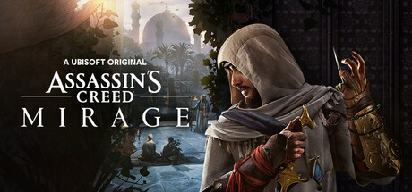

**Assassin's Creed Mirage is a return to the franchise's roots, following young Basim navigating Baghdad's political intrigues in a focused, parkour-heavy stealth adventure. A deliberate step back toward the original AC formula with a tighter, more elegant experience.**

---

## 📖 About

Assassin's Creed Mirage is a return to the franchise's roots, following young Basim navigating Baghdad's political intrigues in a focused, parkour-heavy stealth adventure. A deliberate step back toward the original AC formula with a tighter, more elegant experience.

## ⚠️ Problems Without Trainer

| Problem | Status |
|---------|--------|
| **Tool Dependency** — Most encounters designed around specific assassin tools for optimal stealth | ✅ Solved |
| **Notoriety System** — Failing stealth quickly escalates to near-impossible combat situations | ✅ Solved |
| **Short Length** — 15-20 hour main story feels brief compared to recent Assassin's Creed games | ✅ Solved |
| **Parkour Accuracy** — Parkour sometimes grabs wrong surfaces creating frustrating deaths | ✅ Solved |

## ✅ Solution

The **Assassin's Creed Mirage Trainer** solves all these issues by giving you complete control over the game.

## 🎯 Full Feature List

- Unlimited Resources
- God Mode / Invincibility
- Instant Skill Cooldown
- One-Hit Kill
- Freeze Game Timer
- Unlock All Items & Achievements
- Custom Speed Multiplier
- Save State Anywhere

## 🚀 Quick Start

1. **Disable Windows Defender** temporarily (trainer may trigger false positive)
2. Download the trainer from the button above
3. Launch Assassin's Creed Mirage
4. Run the trainer as Administrator
5. Activate desired cheats with hotkeys

## 💎 Free vs Paid

| Feature | Free | Pro |
|---------|------|-----|
| Basic God Mode | ✅ | ✅ |
| Unlimited Resources | ✅ | ✅ |
| All Advanced Cheats | ❌ | ✅ |
| Auto-Updates | ❌ | ✅ |
| Priority Support | ❌ | ✅ |

## 💻 Requirements

- Windows 10/11 (64-bit)
- Assassin's Creed Mirage (any version)
- .NET Framework 4.8+
- DirectX 11+

## 🍎 macOS

macOS users can use our alternative tool:

## ⚖️ Legal

This trainer is for educational and single-player use only. Use responsibly.

---

